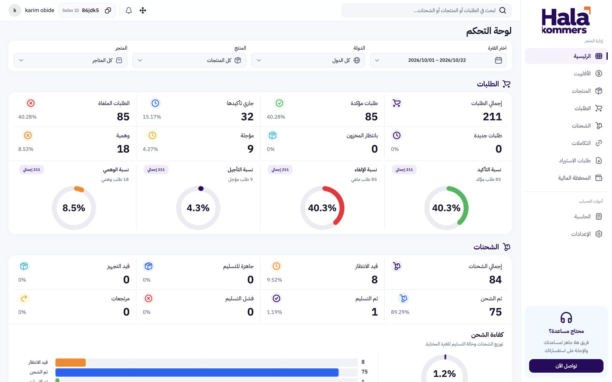

# نظام تصميم هلا كوميرس المعتمد — 2.1

التصميم الحالي معتمد منذ 23 أكتوبر 2026 كأساس دائم لباقي الموقع.

**الدليل الحالي:** [dashboard-heroui/DESIGN.md](../dashboard-heroui/DESIGN.md). يحتوي على الألوان وخط IBM وكثافة المسافات ومقاسات الحقول والقائمة والأيقونات وقواعد الموبايل وحركة الأرقام البسيطة.

**المصدر التنفيذي:** [styles.css](../dashboard-heroui/src/styles.css) ومكونات React + HeroUI المشتركة داخل `dashboard-heroui/src/components/`. تُبنى الصفحات القادمة عليها مع الحفاظ على البيانات الفعلية.

**سجل الاعتماد:** [DESIGN_LOCK.md](../DESIGN_LOCK.md). **النسخة المحفوظة:** `dashboard/releases/2026-10-23-heroui-approved-v2.1/`.

وثيقة 22 أكتوبر القديمة وملف ثوابتها محفوظان داخل `archive/2026-10-22/`. الصور القديمة وملفات تجربة التبويبات والدمج داخل هذا المجلد مراجع تاريخية فقط. `tokens.css` القديم غير مستخدم في التطبيق الحالي؛ مصدر الألوان والمقاسات هو CSS مشروع React.
