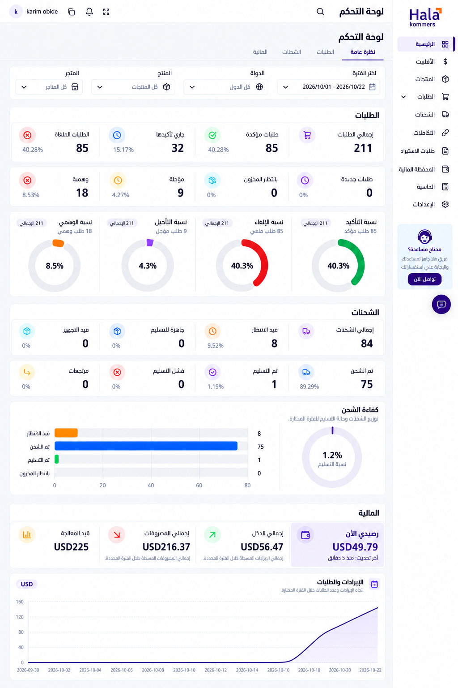

# هلا كوميرس — تجربة الصفحة الواحدة

نسخة للمقارنة، بتاريخ 22 أكتوبر 2026؛ لا تستبدل المرجع المعتمد تلقائيًا.

[فتح الصورة كاملة](assets/single-page-experiment.png)

## التجميع

- هيدر واحد، وقائمة جانبية واحدة، وشريط فلاتر مشترك واحد.
- أقسام متتابعة: الطلبات، ثم الشحنات، ثم المالية.
- تبويبات الأعلى تُستخدم كروابط انتقال داخل الصفحة في هذه التجربة، وتظل الأقسام الثلاثة معروضة.
- شكل المكونات والخط والألوان والدوائر والرسوم مأخوذ من التصميم المختار. لم تُضف بيانات أو جداول جديدة.

## البيانات المحتفظ بها

- الطلبات: 211 إجمالي، 85 مؤكدة، 32 جاري تأكيدها، 85 ملغاة، 0 جديدة، 0 بانتظار المخزون، 9 مؤجلة، 18 وهمية، والنسب الأصلية والدوائر الأربع.
- الشحنات: 84 إجمالي، 8 قيد الانتظار، 0 جاهزة للتسليم، 0 قيد التجهيز، 75 تم شحنها، 1 تم تسليمها، 0 فشل تسليم، 0 مرتجعات، والنسب الأصلية. يبقى رسم توزيع الشحنات ونسبة التسليم 1.2%.
- المالية: الرصيد USD49.79، الدخل USD56.47، المصروفات USD216.37، قيد المعالجة USD225، والرسم الموجود بالمصدر.

## حدود المخرج

تصور بصري مولّد بأداة الصور المدمجة، وليس واجهة مبرمجة. المرجع الطباعي IBM Plex Sans Arabic، ويُحمّل ملف الخط الفعلي عند التنفيذ. المقاس النهائي للصورة 1024×1536. دقة المنحنى اليومية تُراجع من بيانات النظام عند التنفيذ، ولا تستخرج من صورة التصميم.

تم إرفاق التصميم المعتمد والشاشات الثلاث والشعار لتوجيه التوليد. يحدد [نص التوليد](single-page-experiment-prompt.txt) قواعد تثبيت الأسلوب والمحتوى المطلوبة.
