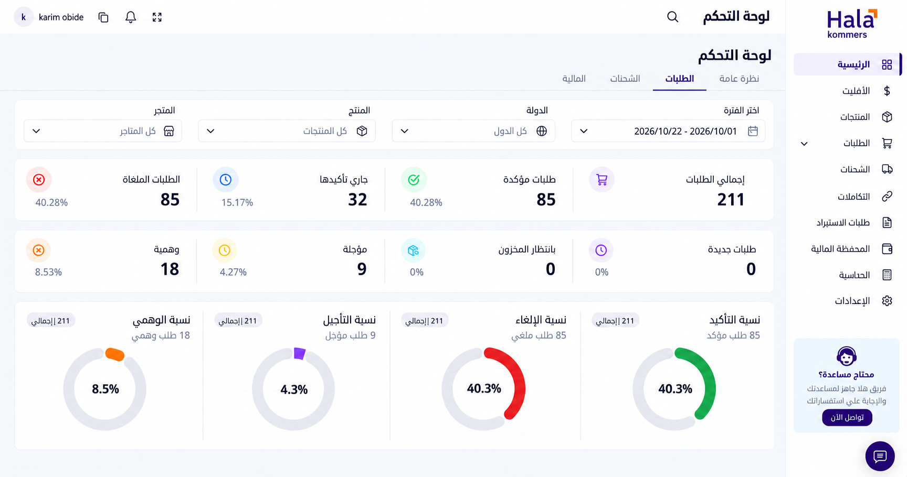
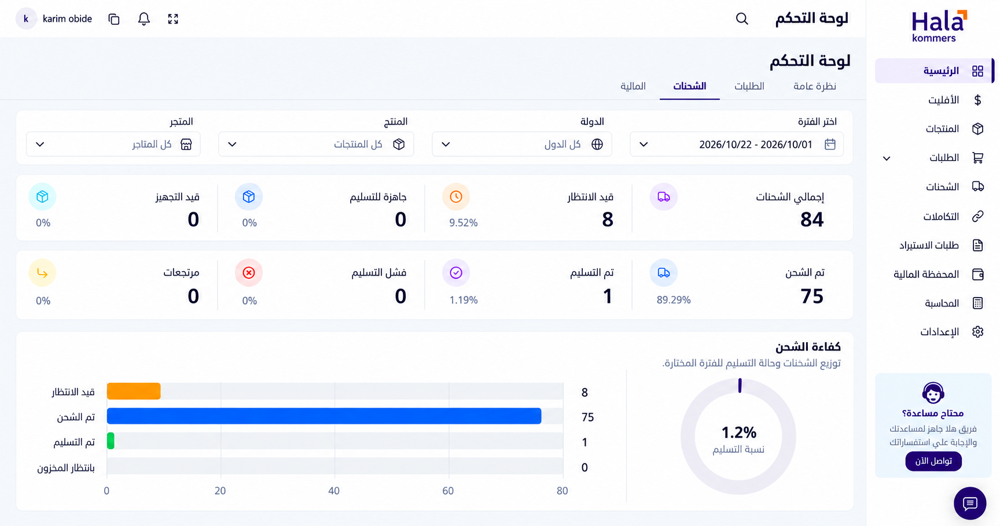
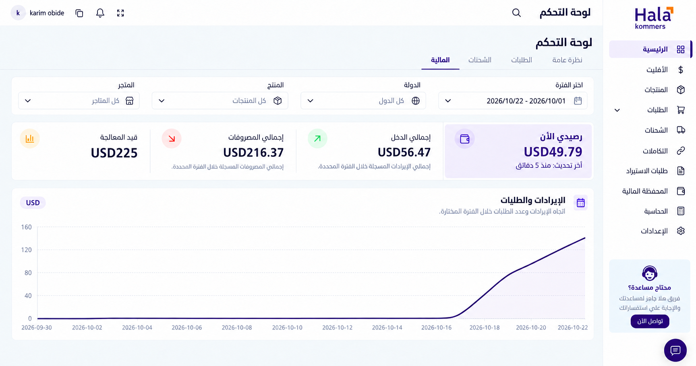

# هلا كوميرس — الطلبات والشحنات والمالية

تصورات بصرية ممتدة من التصميم المختار، بتاريخ 22 أكتوبر 2026. ترتيب العرض أدناه للمراجعة: الطلبات، الشحنات، المالية. هذه الشاشات ليست بدائل أسلوبية؛ كلها تستخدم الاتجاه نفسه.

المرجع: IBM Plex Sans Arabic، بنفسجي هلا `#270A5E`، برتقالي `#FB6B12`، أسطح بيضاء وصفوف مؤشرات موحّدة. المخرجات صور تصميم، وليست واجهة مبرمجة أو متصلة ببيانات حية. يظل ملف الخط الفعلي ومصدر بيانات النظام مطلوبين عند التطبيق.

## الطلبات

[الصورة بالحجم الكامل](assets/orders-analytics.png) · [بيانات الشاشة الأصلية](assets/current-orders-analytics.png)

ثمانية مؤشرات، ونسب التأكيد والإلغاء والتأجيل والوهمي. يحتفظ العرض بقيم المصدر وبفروق التقريب: 40.28% و15.17% و4.27% و8.53% للمؤشرات، و40.3% و40.3% و4.3% و8.5% للدوائر.

## الشحنات

[الصورة بالحجم الكامل](assets/shipments-analytics.png) · [بيانات الشاشة الأصلية](assets/current-shipments-analytics.png)

ثمانية مؤشرات، وتوزيع الشحنات، ونسبة التسليم. إجمالي الشحنات 84، وقيد الانتظار 8، وتم الشحن 75، وتم التسليم 1. تبقى الحالات الصفرية ظاهرة. نسبة التسليم 1.19% في المؤشر، و1.2% في الدائرة، طبقًا للمصدر.

## المالية

[الصورة بالحجم الكامل](assets/financial-analytics.png) · [بيانات الشاشة الأصلية](assets/current-financial-analytics.png)

رصيد USD 49.79، دخل USD 56.47، مصروفات USD 216.37، وقيد المعالجة USD 225، مع الرسم الموجود بالمصدر. شكل المنحنى مرجع بصري وليس سلسلة يومية مستخرجة من النظام. نطاق الرسم يبدأ 2026-09-30؛ تُراجع حدود الفترة الفعلية من مصدر البيانات عند التطبيق، ولا تعتمد أرقام الفلاتر المصوّرة كإعدادات إنتاج.

## تنظيم الاستخدام المقترح

صفحة لوحة تحكم واحدة، بأربعة تبويبات: نظرة عامة، الطلبات، الشحنات، المالية. «نظرة عامة» ملخص، والتبويبات الأخرى للتفاصيل. يظل نطاق الفترة والدولة والمنتج والمتجر محفوظًا عند الانتقال. عرض الصور تحت بعض هنا للمقارنة، ولا يلزم منه عرض محتوى كل التبويبات معًا في واجهة الاستخدام.

## طريقة الإنتاج

استُخدمت أداة توليد الصور المدمجة لإنتاج كل شاشة مستقلة، مع إرفاق التصميم المعتمد وصورة التبويب الأصلي والشعار. توجيه الإنتاج: الحفاظ على كل بيانات التبويب، وتطبيق IBM Plex Sans Arabic وألوان هلا والأسطح المقسّمة من التصميم المختار. تم تعديل صورة المالية لتوحيد منحنى الرسم مع البنفسجي الغامق. جميع المخرجات النهائية 1728×910.

التحقق الحالي بصري من الصور؛ اختبار التفاعل وإمكانية الوصول والخط المحمّل فعليًا يتم بعد التنفيذ.
